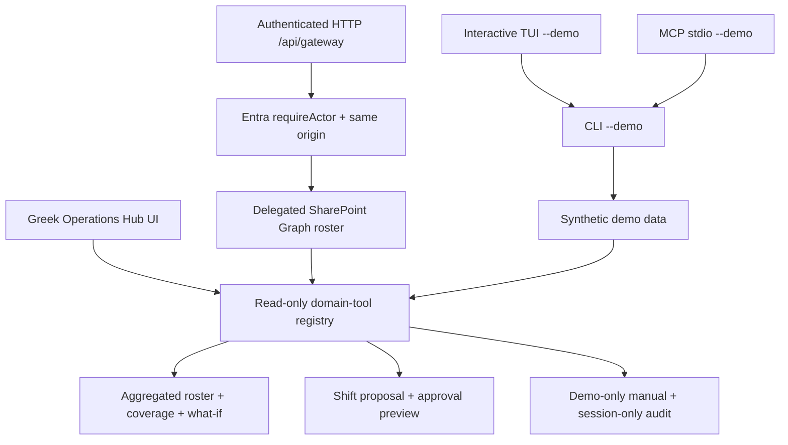

# ShiftOS V1.2 — BiteFoundry-inspired Integration Gateway

## Product Intent / Scope Lock

- **Mission:** accessible Greek station operations workspace (shift scheduling, coverage, checks, approval flow, privacy-preserving reporting).
- **Baseline:** ShiftOS v1.1 RC1, Git commit `313223f01c270aa8a5aafc1cbcd2a3cc745d8b73`, existing `secure-shiftos/` in public GitHub repo.
- **Authorization:** only this feature branch and the protected synthetic-only preview; no corporate roster, ACL, Entra tenant, OneDrive file, existing approved user emails, costs, or legacy Vercel project may be changed.
- **Principle:** take the architectural *pattern* (one kernel, Web/HTTP/CLI/TUI/MCP), not package `@bitefoundry/atlassian`, its proprietary assets, Jira/Confluence APIs, or any credentials.
- **Non-goals:** commercial production, persistent Kanban, AI-model execution, durable audit, automatic emails/approvals, true multi-site federation, AI-agent write access, live reservations or customer data.

## Implementation diagram



The **read-only HTTP adapter** is the only bridge to corporate Graph. It authenticates each request and uses existing individual identities, Graph delegated permissions and application allowlists. There is no global service account or public synthetic HTTP toggle. The `--demo` CLI, menu TUI and MCP stdio server are intentionally offline and require synthetic mode. A full remote corporate MCP protocol is **not** active; no server-side MCP auth or audited tool execution has been approved.

## Seven tool contracts

| Tool | Input | Result | Side effects |
|---|---|---|---|
| `roster.read` | month | employee and shift counts, status | None; aggregates only |
| `coverage.analyze` | month, optional date | daily counts, warnings summary | None |
| `coverage.simulate` | month, date, manual scenario | estimated staffing pressure by window | None; NOT a prediction |
| `shift.propose` | month, date, employeeKey, proposed code | before/after checks | None; NOT saved, human review required |
| `approval.request` | month | preview of issues and next step | **NOT submitted** |
| `manual.search` | month, query | synthetic teaching content ONLY; corporate `available:false` | None |
| `audit.history` | month | synthetic session events ONLY; corporate `available:false` | None |

The HTTP route validates Origin, Content-Type, JSON framing, max payload 8 KiB, input schema, role, existing Entra JWT + delegated Graph token. It cannot bypass the active Excel sharing permissions or corporate SharePoint tenant configuration. Neither MCP tool annotations nor user arguments grant corporate access.

## Usage (local synthetic only)

```bash
npm test
npm run lint:syntax
node scripts/shiftos-cli.mjs --demo list
node scripts/shiftos-cli.mjs --demo call roster.read '{"month":"2026-11"}'
node scripts/shiftos-tui.mjs --demo
node scripts/shiftos-mcp.mjs --demo
```

MCP uses **JSON-RPC 2.0 newline-delimited messages over stdio**, implements `initialize`, `ping`, `tools/list` and `tools/call`, plus notifications without responses. No HTTP MCP endpoint, authentication, progress streaming, or long-running daemon is supplied. For an MCP client configure command `node`, args `[absolute-path-to-scripts/shiftos-mcp.mjs, --demo]` on a trusted workstation. Do not expose this process to a public port.

Authenticated enterprise HTTP requests (not usable until IT config/approval):

```http
POST /api/gateway
Content-Type: application/json
Origin: https://approved-own-origin.example
Cookie: <browser session; managed by browser>

{"tool":"coverage.analyze","arguments":{"month":"2026-11"}}
```

This example host is illustrative only, not a deployment address. Requests are private, noncacheable and must use an individual authorized cookie. The endpoint has no token/secret in source or examples. Production environments intentionally reject access until corporate IT, hosting, and SharePoint policies are configured.

## Nontechnical UX

The Hub has three views:
1. **Εκκρεμότητες:** derived cards grouped by urgency (not persisted Kanban items).
2. **Εργαλεία:** readable names, explicit inputs, summary outputs with status and source.
3. **Πώς λειτουργεί:** four-step Greek explanation of read → simulate → review → approved action.

Disabled integrations are labeled unavailable rather than pretending to be connected. No synthetic result is presented as real. Public/demo source files contain only fictitious names.

## Release / verification evidence

- Existing 67 tests plus new gateway, CLI, MCP and TUI tests must pass.
- Parse JSX and JS; run Vercel preview build; independent visual/authenticated-browser E2E remains required.
- CLI without `--demo` denied; MCP without `--demo` exits without starting server.
- Corporate manual and audit tools return unavailable until supported by approved private data and audit backend.
- Graph 2-editor concurrency and actual business-station deployment remain blocked.

## Risks and next steps

1. **Critical:** original `ΠΡΟΓΡΑΜΜΑ.xlsx` contains anonymous edit links; users with inherited/shared accounts might have unintended access. The Gateway does not resolve this.
2. **Critical:** private Entra + SharePoint Lists, approved source workbook migration and corporate commercial hosting are not available in the preview.
3. **High:** corporate audit requires immutable append-only storage, scopes and retention policy; do not claim UI local events as audit.
4. **High:** all write tools (proposing edits, persisting approvals) need a separate permission and anti-race workflow, human approval, business rules and test evidence before implementation.
5. **High:** true multi-site federation needs station-scoped Entra identity, SharePoint site IDs and per-site policies. Do not expand access by default.
6. **Medium:** MCP protocol compatibility with external clients is unverified; loopback smoke tests are not the same as production conformance.
7. **Medium:** Vercel Hobby is not approved for commercial company operation. No additional paid services were enabled.
8. **Medium:** private end-to-end browser test of the protected preview is not complete.

Rollback: remain on the verified V1.1 preview commit `313223f01c270aa8a5aafc1cbcd2a3cc745d8b73`; the v1.2 branch has not overwritten the baseline branch or original Excel.
